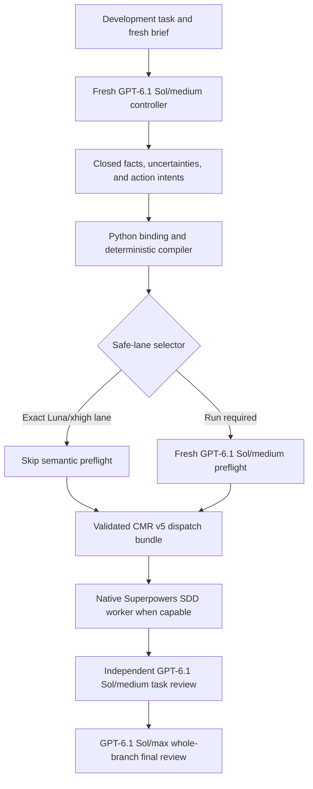

# Codex Model Router

[](https://github.com/luandemelo/codex-model-router/actions/workflows/ci.yml)
[](LICENSE)
[](docs/dependencies.md)

Codex Model Router (CMR) is a deterministic Codex plugin for routing development work between `gpt-6.1-sol` and `gpt-6-luna`. The Sol coordinator and controller classify a bounded task; validated facts and fixed compiler rules determine the worker, effort, and independent review.

CMR assigns clear, bounded, low-risk implementation to Luna/xhigh. Dense local implementation can use Luna/max only after architecture is approved and every published predicate is met. Sol handles diagnosis, judgment, integration, elevated risk, hard gates, recurrence, canonical planning, and final review at the effort fixed by the policy.

> **Distribution status:** this repository contains the public skills-only plugin package at version `0.10.0`. Install the skill directly from the repository or test the complete plugin locally.

## Contents

- [Why CMR exists](#why-cmr-exists)
- [When to use it](#when-to-use-it)
- [Quick start](#quick-start)
- [How it works](#how-it-works)
- [Routing policy](#routing-policy)
- [Core concepts](#core-concepts)
- [CLI and contracts](#cli-and-contracts)
- [Dependencies](#dependencies)
- [Authorization and safety](#authorization-and-safety)
- [Repository layout](#repository-layout)
- [Contributing](#contributing)
- [Project status and license](#project-status-and-license)

## Why CMR exists

Development tasks do not all have the same blast radius. Updating isolated copy, reconciling a small data set, changing a database schema, diagnosing a race condition, and reviewing a release need different routes.

A deadline, cost request, or optimistic task description should not weaken a route. CMR separates model judgment from routing authority:

- the GPT-6.1 Sol controller reports only closed facts, uncertainties, and action intents;
- Python binds that report to fresh task evidence;
- the compiler applies a fixed route precedence;
- the dispatcher accepts only a complete, validated handoff;
- every Luna worker receives independent GPT-6.1 Sol/medium task review, while whole-branch final review uses Sol/max.

The compiler, not model prose, owns model, effort, review, recurrence, lifecycle, and external-action decisions.

## When to use it

Use CMR before delegating development work through Superpowers SDD when task risk, blast radius, repeated failures, architecture, security, concurrency, migrations, or release review should affect execution. CMR also records why a route was selected and keeps external actions separately authorized.

The current coordination and controller route is GPT-6.1 Sol/medium. Luna/xhigh is the default for eligible clear, bounded, low-risk implementation. Luna/max is restricted to dense implementation with approved architecture, low blast radius, no uncertainty, no audit, judgment, or reconciliation, and no higher-precedence gate.

CMR is unnecessary for conversations that do not dispatch development work or need controlled routing.

## Quick start

### 1. Check the host requirements

You need:

- a Codex app, CLI, or IDE surface with skills and native collaboration;
- access to the exact model slugs `gpt-6.1-sol` and `gpt-6-luna`, and the required efforts;
- Superpowers with `superpowers:subagent-driven-development`;
- Python 3.10 or newer and Git for local validation and contribution.

Native collaboration is mandatory whenever it supports the occurrence's exact model, effort, fresh context, isolation, and permission requirements. A busy native slot means wait. CLI is permitted only for an occurrence-scoped, documented native capability gap, after notifying the user that the CLI child will not be registered in the main conversation's subagent panel. Convenience, JSON capture, cost, and permission bypass do not qualify. If no admitted transport meets every requirement, stop. Host registration alone does not prove that an agent rendered in the panel; visual confirmation needs UI observation or explicit user confirmation.

See [Dependencies](#dependencies) and the skill's [dependency preflight](skills/codex-model-router/references/dependency-preflight.md) for the complete boundary.

### 2. Install the skill directly from GitHub

In a Codex conversation, invoke the built-in skill installer with the public skill path:

```text
$skill-installer Install the skill from https://github.com/luandemelo/codex-model-router/tree/main/skills/codex-model-router
```

The installed skill becomes available on the next turn. Start a fresh conversation before evaluating its routing behavior.

### 3. Route a development task

Invoke the skill and include the task, constraints, and repository context:

```text
$codex-model-router Route this task before implementation:

Update the isolated settings-page copy. Preserve the existing behavior and
include a focused review of the change.
```

This is a clear, bounded, low-risk implementation unit, so it routes to Luna/xhigh with an independent Sol/medium task review. A schema migration is a hard gate and routes to Sol/max, with separate Sol/max review. The compiler classifies each unit on its own, even when an initiative contains other risky work.

CMR prepares and validates a route. It does not silently push code, create an issue, merge a pull request, deploy, or publish a release.

### Full plugin testing

The repository also contains `.codex-plugin/plugin.json`. Maintainers testing the complete plugin can add it to a local marketplace, install it, start a new conversation, and run representative positive, negative, and boundary requests. See the [official plugin testing guide](https://developers.openai.com/plugins/deploy/connect-chatgpt).

## How it works



The control flow has six stages:

1. **Host preflight:** check the actual model/effort and workflow capabilities before the Sol controller. Native collaboration is the required transport whenever capable.
2. **Controller:** a fresh GPT-6.1 Sol/medium occurrence emits only a closed `cmr-controller-result-v4` envelope.
3. **Binding and compilation:** runtime code binds the response and required gate evidence to the brief and audited occurrence; the compiler derives risk, recurrence, worker route, review route, lifecycle, and external-action state.
4. **Preflight selection:** only an exact current Luna/xhigh safe-lane entry can skip fresh Sol/medium semantic preflight. Luna/max always runs preflight, which independently checks gate evidence relevance.
5. **Dispatch:** a complete CMR v5 dispatch bundle must validate before handoff. Nonempty replacement gate claims require independent Sol/medium confirmation before dispatch.
6. **Execution and review:** Superpowers SDD receives the validated brief; both Luna efforts get fresh independent Sol/medium task review. Whole-branch final review remains a separate Sol/max occurrence.

A CLI exception is scoped to the occurrence with a real native capability gap and requires prior user notification, including the loss of native panel registration. It preserves the exact model, effort, fresh context, isolation, permissions, skills, and dependencies. If any requirement cannot be met, stop. Registration and visible panel confirmation are separate facts.

For the detailed invariants, read [architecture](docs/architecture.md), [routing policy](skills/codex-model-router/references/routing-policy.md), and [execution contract](skills/codex-model-router/references/execution-contract.md).

## Routing policy

The compiler applies the first matching rule to each bounded unit:

| Validated situation | Worker | Fresh task review |
| --- | --- | --- |
| Hard gate, recurring/reappeared defect, canonical planning, or whole-branch final review | GPT-6.1 Sol/max | GPT-6.1 Sol/max |
| Integration or elevated risk | GPT-6.1 Sol/high | GPT-6.1 Sol/high |
| Diagnosis, audit, judgment, reconciliation, or complex local work missing a dense-lane predicate | GPT-6.1 Sol/medium | GPT-6.1 Sol/medium |
| Dense approved bounded local implementation | GPT-6 Luna/max | GPT-6.1 Sol/medium |
| Clear, isolated, low-risk implementation | GPT-6 Luna/xhigh | GPT-6.1 Sol/medium |

The dense Luna/max lane requires all of these: `task_phase: "implementation"`; facts `complex_local_execution`, `architecture_approved`, and `low_blast_radius`; no uncertainty IDs; none of `audit`, `judgment_required`, or `reconciliation`; and no higher-precedence gate. `architecture_approved` means architecture and interfaces are already decided. If any condition is absent, the dense route does not apply.

Sol/medium diagnosis applies only when the same occurrence supports no stronger gate. A supported hard-gate or integration/elevated-risk fact takes precedence in that occurrence; do not defer it to a later unit.

The coordinator, controller, semantic preflight, and default review use Sol/medium. Canonical plan certification, hard gates, recurrence, and whole-branch final review use Sol/max. Both Luna routes use independent Sol/medium task review. There is no silent model or effort fallback when a route is unavailable.

Every asserted hard-gate or integration/elevated-risk fact needs occurrence-specific evidence tied to the task brief and the exact audited source. Claims need a verifiable quote, a positive basis (requested change, concrete decision, or critical assurance), and an explanation of why the brief requires the gate. Context, negation, preserved constraints, filenames, test presence, and ordinary build choices alone do not establish risk. Missing, contradictory, context-only, or invalid evidence blocks; do not delete facts or silently down-route. Structural checks prove binding and coverage, not natural-language relevance, which preflight must assess against the full task and phase.

Cost, quota, urgency, deadlines, authority, sunk cost, diff size, and social pressure never lower a compiled route. Semantic preflight adjudicates the control plane; it cannot act as worker execution or replace task review. Historical Quality-First Routing (QFR) records remain documentary and cannot authorize CMR dispatch.

See [GPT-6 routing](docs/gpt6-routing.md) for the current profile and [migration guidance](docs/migration-from-quality-first-routing.md) for the public 0.5.0-to-0.10.0 upgrade. Benchmark rationale and its limits are documented in [policy basis](skills/codex-model-router/references/policy-basis.md).

## Core concepts

| Term | Meaning |
| --- | --- |
| **Controller** | Fresh GPT-6.1 Sol/medium call that reports only ontology-backed facts, uncertainties, and action intents. |
| **Occurrence** | Audited record of one model call, including phase, scope, hashes, usage, thread policy, and acceptance state. |
| **Compiler** | Standard-library Python code that owns route precedence and derives the complete decision. |
| **Safe lane** | Frozen, plan-bound evidence for a narrowly eligible Luna/xhigh task that may skip semantic preflight. |
| **Semantic preflight** | Fresh Sol/medium control-plane adjudication that can accept, replace with a stronger route, or block. |
| **Gate evidence** | Occurrence-bound positive evidence that connects every asserted hard or elevated-risk fact to the requested brief. |
| **Dispatch bundle** | Complete validated handoff containing route evidence, preflight state, and the materialized worker brief. |
| **Recurrence** | Repeated failure of the same bound defect; recurrence routes to Sol/max. |
| **Hard gate** | A fact such as security-sensitive work, schema migration, concurrency, architecture, or final review that routes to Sol/max. |
| **External action** | A separately authorized mutation such as issue creation, push, PR, merge, deployment, tag, release, installation, or publication. |

## CLI and contracts

The skill includes standard-library Python commands for contract validation, compilation, migration inspection, dispatch request materialization, and occurrence auditing:

```bash
python3 -B skills/codex-model-router/scripts/codex_model_router.py --help
```

| Command | Purpose |
| --- | --- |
| `validate-controller` | Validate one closed controller result. |
| `compile` | Bind validated evidence and derive the complete route decision. |
| `validate-dispatch` | Validate a complete CMR dispatch bundle before handoff. |
| `dispatch-request` | Materialize the exact worker request from a validated bundle and ledger. |
| `validate-legacy` | Inspect one historical QFR decision without authorizing dispatch. |
| `audit-occurrence` | Validate call shape, metadata binding, response policy, and usage for one occurrence. |
| `check-call-shape` | Validate the existing v4 core call shape; it does not include gate-confirmation accounting. |
| `check-execution-call-shape` | Report complete accounting for core calls and packet-bound gate-confirmation attempts. |

Commands read JSON or JSONL files, emit canonical JSON, return zero only for accepted input, and write rejection diagnostics to stderr. Controller, route-decision, runtime-input, and route-evidence contracts remain CMR v4/v5. Current dispatch requires bundle-v5 and preflight-invocation-v5 with gate-evidence-v1; older bundle formats do not dispatch. Inspect historical CMR v4 artifacts with the retained 0.9.0 source, schemas, and package; `qfr_legacy.py` inspects QFR records only. See the machine-readable schemas and [execution contract](skills/codex-model-router/references/execution-contract.md) for the current boundary.

The existing v4 call-shape check and accounting summary describe core calls only. For complete accounting, use `python -B skills/codex-model-router/scripts/codex_model_router.py check-execution-call-shape INPUT LEDGER_ROOT`. The facade binds confirmation attempts to replaced-preflight packets, partitions the full observed occurrence inventory, and counts unique immutable raw-call identities once. Known usage is summed once; aggregate usage is null if any contributing usage is missing or invalid, with incompleteness reported. A genuine `block` is one confirmation call, not a retry; extra attempts remain separate from the core-only retry count. Accounting does not authorize dispatch. See the [execution contract](skills/codex-model-router/references/execution-contract.md) for Python signatures, exact input/report schemas, and CLI response rules.

For new compilation, pass both the bound gate sidecar and exact brief explicitly:

```bash
python -B skills/codex-model-router/scripts/codex_model_router.py compile INPUT [RUNTIME] --gate-evidence SIDECAR_PATH --brief BRIEF_PATH
```

Both flags are required for either CLI form. `INPUT`, optional `RUNTIME`, sidecar, and brief are read as frozen inputs without following symlinks; files with write-permission bits are rejected. The brief path binds to the exact brief reference in the evidence. Missing flags or invalid input files produce one JSON error, exit 1, and no route decision.

## Dependencies

Required host capabilities:

- Codex with skills and native collaboration that can meet the exact occurrence requirements;
- access to `gpt-6.1-sol` at medium, high, and max, and `gpt-6-luna` at xhigh and max;
- Superpowers with `superpowers:subagent-driven-development` (host dependency, not bundled);
- Python 3.10+ using the standard library only;
- Git for local history and review workflows.

A documented, pre-disclosed CLI exception may cover only a real occurrence-scoped native transport gap. It cannot bypass a permission denial or relax any model, effort, context, isolation, skill, or dependency requirement. If no admitted transport can satisfy the occurrence, stop.

There is no runtime PyPI, npm, database, hosted-service, API-key, or MCP dependency. GitHub CLI and GitHub Issues are optional integrations for separately authorized repository workflows. See [dependency documentation](docs/dependencies.md) for the full matrix and limitations.

## Authorization and safety

CMR separates preparation from permission. Issue creation, repository settings, pushes, pull requests, merges, deployments, tags, releases, plugin installation, and marketplace publication each require their own scoped authorization, exact preview, execution, and readback.

A previous approval, generic GitHub permission, or prepared preview does not authorize a different action. CMR records the lifecycle state but has no automatic GitHub network or shell side effects.

CMR does not:

- observe or validate a model's hidden reasoning;
- guarantee account access to a model or reasoning effort;
- create missing evidence, retry malformed model responses, or repair an invalid route;
- replace human review for business, security, legal, or operational risk;
- turn historical QFR artifacts into current dispatch authority.

Report vulnerabilities privately using [SECURITY.md](SECURITY.md).

## Repository layout

```text
.
├── .codex-plugin/plugin.json       # Plugin identity and skill entry point
├── .github/workflows/ci.yml        # Python 3.10-3.13 verification
├── docs/                           # Architecture, dependencies, migration
├── skills/codex-model-router/
│   ├── SKILL.md                    # Codex workflow instructions
│   ├── agents/openai.yaml          # Skill interface metadata
│   ├── assets/                     # Reusable AGENTS.md routing snippet
│   ├── references/                 # Policies, ontologies, and JSON Schemas
│   ├── scripts/                    # Runtime, compiler, dispatcher, and CLI
│   └── tests/                      # Deterministic unit and contract tests
├── CONTRIBUTING.md                 # Contribution workflow and DCO
├── SECURITY.md                     # Private vulnerability reporting
└── CHANGELOG.md                    # Public release history
```

## Contributing

Bug reports, documentation improvements, new deterministic test cases, policy clarifications, compatibility fixes, and narrowly scoped implementation changes are welcome.

Before opening a pull request:

1. Start with a clear issue or specification and keep the change focused.
2. Create a branch from `main`.
3. Add a deterministic regression test before behavior changes.
4. Update documentation and `CHANGELOG.md` when public behavior or contracts change.
5. Run the complete local checks.
6. Sign every commit with the Developer Certificate of Origin.

Clone and verify the project without installing runtime dependencies:

```bash
git clone https://github.com/luandemelo/codex-model-router.git
cd codex-model-router
python3 -B -m unittest discover -s skills/codex-model-router/tests -p 'test_*.py' -v
python3 -B skills/codex-model-router/scripts/check_public_release.py .
git diff --check
```

Sign a commit with:

```bash
git commit -s
```

A contribution is ready for review when tests pass, the public release checker reports zero errors, JSON and documentation remain valid, the diff contains no private data or generated caches, and the pull request explains the problem, the chosen approach, and the verification evidence.

Read [CONTRIBUTING.md](CONTRIBUTING.md) for the full DCO and submission requirements. Use [SECURITY.md](SECURITY.md) instead of a public issue for a suspected vulnerability.

## Project status and license

The current public package version is `0.10.0`. It preserves the validated 0.8 routing matrix and native-first transport policy while requiring occurrence-bound gate evidence for dispatch. Local profile updates 0.6.0 through 0.8.0 were not published GitHub releases; 0.9.0 was the preceding public package. Release and migration history is recorded in [CHANGELOG.md](CHANGELOG.md); preserve sealed historical evidence and use fresh plans, ledgers, and evidence for new work.

Codex Model Router is licensed under the [Apache License 2.0](LICENSE). See [NOTICE](NOTICE) for attribution details.
